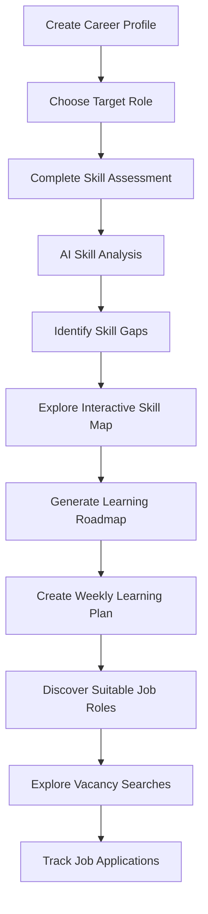

# BaySkills — AI-Based Skill Gap Analyser

<p align="center">
  
</p>

<p align="center">
  <strong>Understand your skill gaps. Build a focused learning path. Find roles that fit.</strong>
</p>

BaySkills is an AI-powered career-readiness platform designed to help students, learners, and early-career professionals move from their current skill level towards a chosen career role.

Instead of acting as a professional social network, BaySkills focuses on practical career preparation: assessing skills, identifying areas that need improvement, visualising the skills required for a role, creating a learning plan, discovering relevant job opportunities, and tracking applications.

---

## Table of Contents

- [Project Overview](#project-overview)
- [How BaySkills Works](#how-bayskills-works)
- [Core Features](#core-features)
- [Technology Stack](#technology-stack)
- [Getting Started](#getting-started)
- [Environment Configuration](#environment-configuration)
- [Project Structure](#project-structure)
- [How the AI Analysis Works](#how-the-ai-analysis-works)
- [Current Scope and Limitations](#current-scope-and-limitations)
- [Privacy and Security](#privacy-and-security)
- [Future Improvements](#future-improvements)
- [Contributing](#contributing)
- [License](#license)

## Project Overview

Choosing a career is only the first step. A learner also needs to understand what skills a role requires, evaluate their current abilities, identify missing competencies, and decide what to learn next.

BaySkills addresses this challenge through a structured workflow:

1. A user creates a career profile and selects a target role.
2. The user completes a short, role-specific skill assessment.
3. The platform analyses the user's skills and highlights important skill gaps.
4. An interactive skill flowchart presents the learning sequence for the selected role.
5. The platform generates a personalised learning roadmap and weekly study plan.
6. AI suggests related job roles based on the user's assessed skill profile.
7. The user explores live vacancy searches on external job platforms.
8. The user records applications and tracks their progress.

The project follows the core idea of the **AI-Based Skill Gap Analyser**: compare a candidate's current abilities with the skills expected for a target career, then turn the results into practical next steps.

## How BaySkills Works



## Core Features

### 1. Career Profile

Set up a personal career profile, choose a target job role, and optionally provide a public GitHub username. The selected role is used to personalise the assessment, skill analysis, roadmap, and job-role suggestions.

### 2. Role-Specific Skill Assessment

BaySkills can generate a **15-question multiple-choice assessment** for the selected role. The questions are organised across five skill areas, with three questions per skill and a progression from easier to more challenging questions.

The result provides an indicative level:

- Beginner
- Intermediate
- Advanced

Assessment results are used as evidence during the skill analysis.

### 3. AI-Based Skill Gap Analysis

The AI analysis estimates the user's proficiency across relevant skills and compares it with the expected proficiency for the selected role.

The analysis includes:

- Role-readiness score
- Current skill levels
- Expected skill levels
- Evidence and observations
- High-, medium-, and low-priority skill gaps
- Suggested actions and project ideas for improvement

This helps users identify **what they should focus on first**, rather than treating every missing skill as equally important.

### 4. Interactive Career Skill Map

The Skill Map turns a career path into a staged, clickable flowchart.

It currently includes example paths for:

- Data Scientist
- Data Analyst
- Machine Learning Engineer
- Frontend Developer
- Backend Developer
- Cybersecurity Analyst

Each path is organised into learning stages, such as foundations, core technical skills, advanced practice, production skills, and portfolio projects.

Clicking a skill node opens YouTube search results focused on free courses or playlists for that topic. The map also displays the assessed skill level where matching assessment data is available.

### 5. Personalised Learning Roadmap

Generate a phased learning roadmap based on the selected career role and the skill gaps found during analysis.

A roadmap can include:

- Learning phases and estimated timelines
- Skills to cover
- Practical learning tasks
- Project suggestions
- Learning resources
- Milestones

### 6. Weekly Learning Planner

Convert the roadmap into a manageable weekly plan. Choose the number of hours available per week and the duration of the plan, then mark tasks as complete to track learning progress.

### 7. Job Role Matching and Vacancy Discovery

BaySkills suggests related job roles and provides an estimated match percentage with an explanation of why each role may fit the user's current profile.

Users can open role-specific searches on external job platforms, including:

- LinkedIn Jobs
- Naukri
- Indeed

A suggested role can also be sent to the application tracker.

### 8. Application Tracking

Keep job applications organised in one place. Each record can include:

- Company name
- Job title
- Application date
- Job-post URL
- Follow-up date
- Personal notes
- Application status

Available application stages:

`Saved → Applied → Interview → Offer / Rejected`

The tracker is manually updated by the user. It helps maintain an overview of applications and follow-up actions.

### 9. Baymax Career Assistant

The integrated Baymax assistant can answer questions using the career information available in the user's BaySkills profile. It can help explain skill gaps, discuss learning priorities, and guide users through their roadmap and weekly plan.

### 10. Progress and Achievements

The platform includes progress indicators and achievement badges for activities such as completing an assessment, generating a roadmap, finishing planner tasks, and tracking applications.

---

## Technology Stack

| Layer | Technology |
|---|---|
| Backend | Python, FastAPI |
| Frontend | HTML, CSS, JavaScript |
| AI integration | Groq API |
| AI model | Configurable through `GROQ_MODEL` |
| Database | SQLite |
| API requests | HTTPX |
| Data validation | Pydantic |
| Configuration | python-dotenv |
| Server | Uvicorn |
| External profile data | Public GitHub API |

## Getting Started

### Prerequisites

Install the following before running the project:

- Python 3.10 or later
- pip
- A Groq API key for AI-powered features
- Optional: a GitHub personal access token for higher GitHub API rate limits

### 1. Clone the repository

```bash
git clone https://github.com/YOUR-USERNAME/YOUR-REPOSITORY.git
cd YOUR-REPOSITORY
```

Replace the repository URL with your GitHub repository URL.

### 2. Create a virtual environment

**Windows**

```bash
python -m venv .venv
.venv\Scripts\activate
```

**macOS / Linux**

```bash
python3 -m venv .venv
source .venv/bin/activate
```

### 3. Install dependencies

```bash
pip install -r requirements.txt
```

### 4. Configure environment variables

Create a `.env` file in the project root.

**Windows**

```bash
copy .env.example .env
```

**macOS / Linux**

```bash
cp .env.example .env
```

Open `.env` and add your configuration:

```env
GROQ_API_KEY=your_groq_api_key_here
GROQ_MODEL=llama-3.3-70b-versatile

# Optional: GitHub API token for higher rate limits
GITHUB_TOKEN=

# Use 1 only when deployed behind HTTPS
COOKIE_SECURE=0
```

 Open BaySkills

Visit:

```text
Bayskills.onrender.com
```

Create an account to start using the platform.

---

## Environment Configuration

| Variable | Required | Description |
|---|---|---|
| `GROQ_API_KEY` | Yes, for AI features | API key used for AI analysis, quizzes, roadmaps, and assistant responses |
| `GROQ_MODEL` | No | Groq model identifier. Defaults to `llama-3.3-70b-versatile` |
| `GITHUB_TOKEN` | No | Optional token to improve GitHub API rate limits |
| `COOKIE_SECURE` | No | Set to `1` when running behind HTTPS |

The application can start without optional GitHub integration, but AI-powered features require a valid Groq API key.

## Project Structure

```text
BaySkills/
│
├── app.py                  # FastAPI backend and API endpoints
├── requirements.txt        # Python dependencies
├── .env.example            # Example environment configuration
├── .gitignore
├── README.md
│
└── static/
    ├── index.html          # Frontend application
    ├── bayskills-logo.png  # BaySkills logo
    ├── favicon.png
    ├── baymax3d.js         # Baymax 3D interaction
    ├── baymax-hello.jpg
    │
    ├── fonts/              # Custom font assets
    │
    └── models/             # 3D Baymax model and assets
        ├── BayMax.gltf
        ├── BayMax.bin
        └── images/
```

The SQLite database (`skillgap.db`) is created by the application at runtime and should not be committed to the repository.

## How the AI Analysis Works

BaySkills combines user-provided career information with available assessment and GitHub evidence.

1. The user selects a target role.
2. The application can retrieve public repository information from GitHub when a username is provided.
3. The user may complete a role-specific skill test.
4. The backend sends the relevant profile, GitHub information, and quiz results to the configured Groq model.
5. The model returns structured information about role readiness, skills, proficiency levels, gaps, and related job roles.
6. BaySkills displays the analysis and uses it to support the skill map, learning roadmap, and job-role recommendations.

AI-generated proficiency estimates are guidance, not formal certifications or guaranteed measures of professional ability.

## Current Scope and Limitations

BaySkills is a working project, but some features use external search links or estimates rather than direct integrations.

- **LinkedIn comparison:** The current version does not scrape or compare private LinkedIn member profiles. Its skill benchmark is AI-estimated for the selected role. A future evidence-based comparison could use aggregated skill requirements from permitted job-description sources.
- **Vacancy discovery:** Job links open live searches on external platforms. The current version does not provide a verified, internally aggregated vacancy feed.
- **Learning resources:** Skill nodes open YouTube playlist-focused search results. These results are not pre-screened or endorsed courses; users should review course quality and relevance.
- **Application updates:** Application statuses and follow-up dates are maintained by the user. The platform does not log in to employer portals or automatically detect hiring updates.
- **GitHub analysis:** GitHub review uses publicly available repository information. It cannot reliably measure every aspect of a developer's ability.
- **AI results:** Recommendations and match percentages are estimates and should be treated as decision-support information, not guarantees.

## Privacy and Security

- Passwords are stored as salted scrypt hashes.
- Session cookies are configured as HTTP-only.
- Keep API keys in environment variables and out of source control.
- Use HTTPS and set `COOKIE_SECURE=1` in production.
- Do not commit `.env`, database files, private user data, or credentials.
- Before public deployment, add appropriate rate limiting, monitoring, backups, and production security configuration.

## Future Improvements

Potential areas for future development include:

- Skill benchmarks based on aggregated, permitted job-description data.
- Direct vacancy aggregation through authorised job APIs or licensed providers.
- More detailed skill assessments with practical coding tasks.
- Verified and curated learning resources for each skill node.
- Application reminders and optional calendar integration.
- More career paths and customisable skill maps.
- Stronger progress analytics and learning outcome tracking.

## Contributing

Contributions, suggestions, and bug reports are welcome.

1. Fork the repository.
2. Create a feature branch:

   ```bash
   git checkout -b feature/your-feature-name
   ```

3. Commit your changes:

   ```bash
   git commit -m "Add: your feature description"
   ```

4. Push your branch and open a Pull Request.

Please keep changes focused on BaySkills' main goal: practical skill development and career readiness.

## License

No license has been specified yet. Add a `LICENSE` file before presenting the project as open source or permitting reuse under particular terms.
