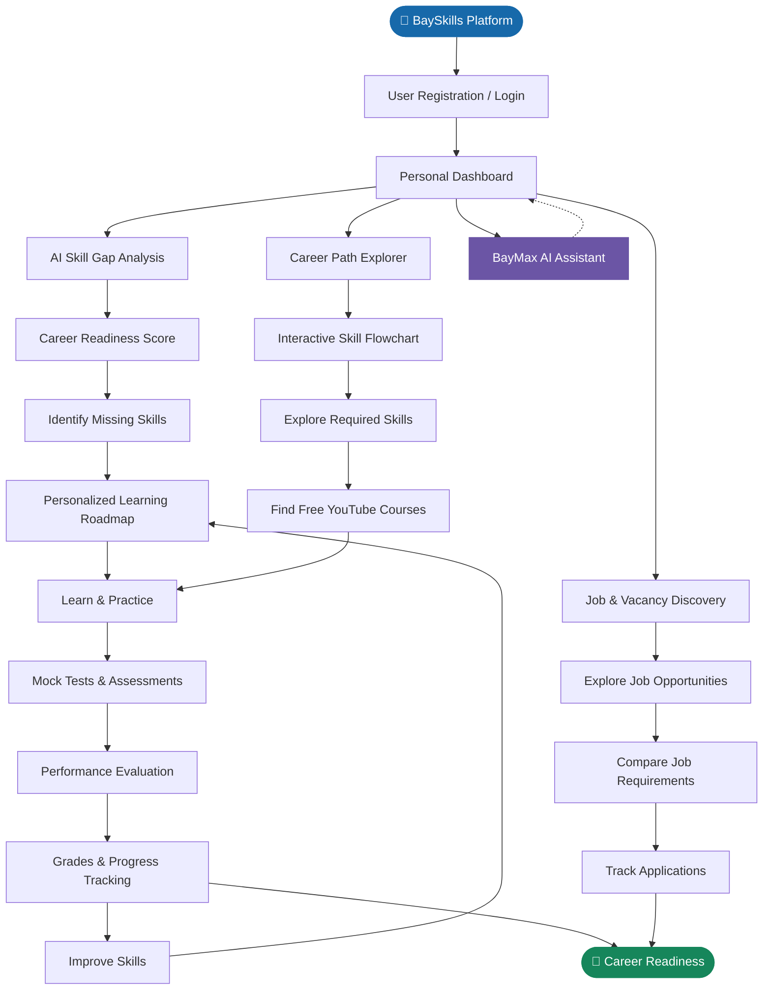
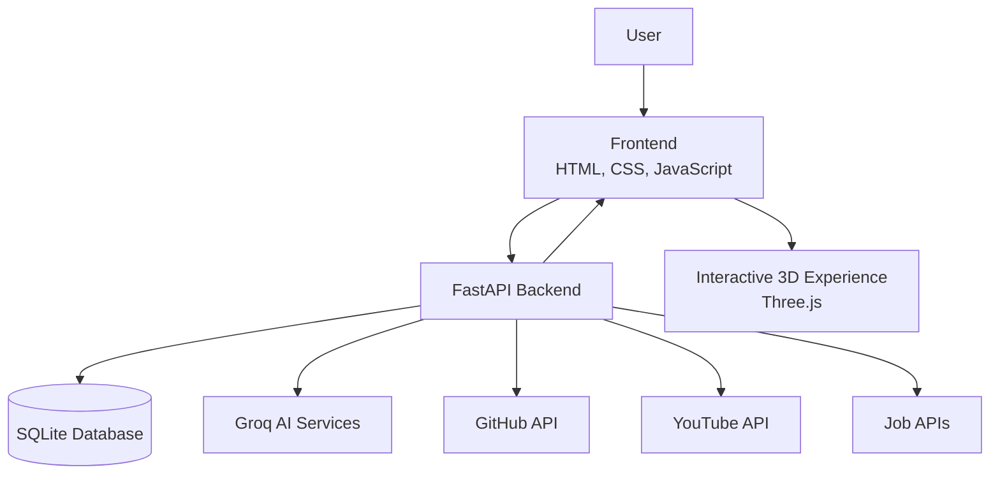

# BaySkills — AI-Powered Career & Skill Development Platform

  

<h3 align="center">Bridging the gap between skills and career opportunities.</h3>

  

  <strong>AI • Career Development • Skill Assessment • Learning</strong>

---

## About the Project

**BaySkills** is an AI-powered career development platform designed to help students and aspiring professionals identify skill gaps, explore career paths, develop technical skills, and prepare for real-world employment opportunities.

The platform brings together AI-driven skill analysis, interactive career flowcharts, personalized learning roadmaps, mock assessments, and job vacancy discovery into one integrated environment.

Instead of navigating multiple platforms for career planning and preparation, users can access essential career development tools through a single platform.

**Our vision is to bridge the gap between academic learning and industry requirements.**

---

## Platform Workflow

The following flowchart illustrates the major functionalities of BaySkills and how they work together to guide users towards their career goals.

---

## Key Features

### 1. AI-Powered Skill Gap Analysis
- Evaluates existing skills against selected career roles.
- Identifies missing technical and professional skills.
- Generates a career readiness score.
- Provides personalized improvement recommendations.

### 2. Interactive Career Flowcharts
- Explore career paths such as Data Scientist, Web Developer and other technical professions.
- Visualize the skills required for different career roles.
- Navigate through interactive skill nodes.
- Discover free YouTube courses and playlists for individual skills.

### 3. AI-Powered Mock Tests
- Practice technical assessments.
- Attempt questions across different topics and difficulty levels.
- Receive grades and performance evaluations.
- Identify areas that require further improvement.

### 4. Personalized Learning Roadmaps
- Follow structured, career-specific learning paths.
- Understand the recommended learning sequence.
- Track skill development and learning progress.

### 5. Job & Vacancy Discovery
- Explore relevant job opportunities.
- Understand industry and employer skill requirements.
- Compare existing skills with job requirements.
- Track job applications.

### 6. BayMax AI Assistant
- AI-powered assistance integrated into the platform.
- Support for career exploration and skill development.
- Interactive assistant experience.

### 7. GitHub Profile Integration
- Access GitHub profile information.
- Use available repositories and development activity as supporting information for skill analysis.

### 8. Interactive User Dashboard
- Centralized access to career development tools.
- View learning and assessment progress.
- Manage career preparation activities.

---

## Technology Stack

| Category | Technologies |
|---|---|
| Frontend | HTML5, CSS3, JavaScript |
| Backend | Python, FastAPI |
| AI Integration | Groq API |
| Database | SQLite |
| 3D Graphics | Three.js, WebGL |
| External APIs | GitHub API, YouTube API, Job APIs |
| Deployment | Render |
| Version Control | Git, GitHub |

---

## Project Architecture

BaySkills follows a client-server architecture that connects its frontend, backend, database, AI services, and external APIs.

---

## Project Objectives

- Simplify career planning and skill development.
- Bridge the gap between academic education and industry expectations.
- Help students identify and improve missing technical skills.
- Provide structured and career-specific learning pathways.
- Encourage practical learning through assessments.
- Connect learning progress with real-world employment opportunities.
- Make career preparation more accessible and organized.

---

## Live Deployment

  

**Live Website:** https://bayskills.onrender.com

**Hosting Platform:** Render

---

## Team ByteBuilders

  <strong>Designed and developed by Team ByteBuilders</strong>

| Team Member | Role |
|---|---|
| **Kartik** | Development |
| **Krishna** | Development |
| **Ayush** | Development |

---

  
   
  <strong>TEAM BYTEBUILDERS</strong>
    
  <i>Learn. Build. Assess. Grow.</i>
    
  <a href="https://bayskills.onrender.com">Explore BaySkills</a>

